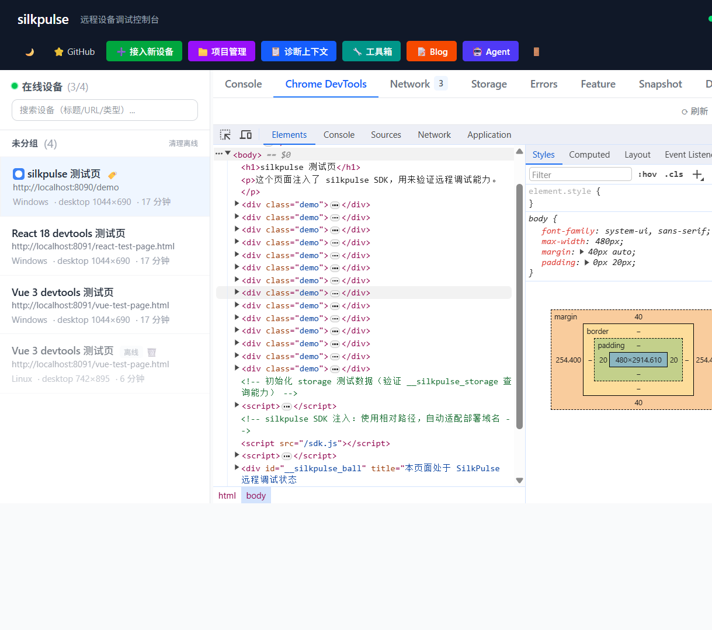
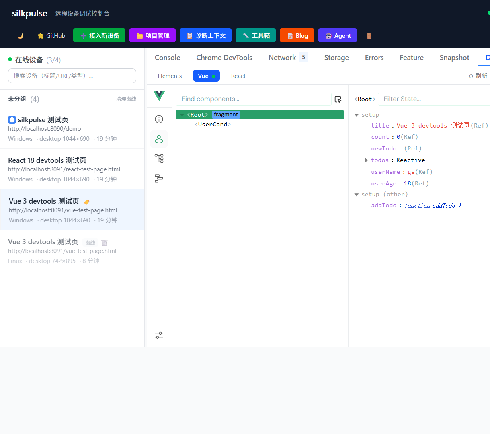
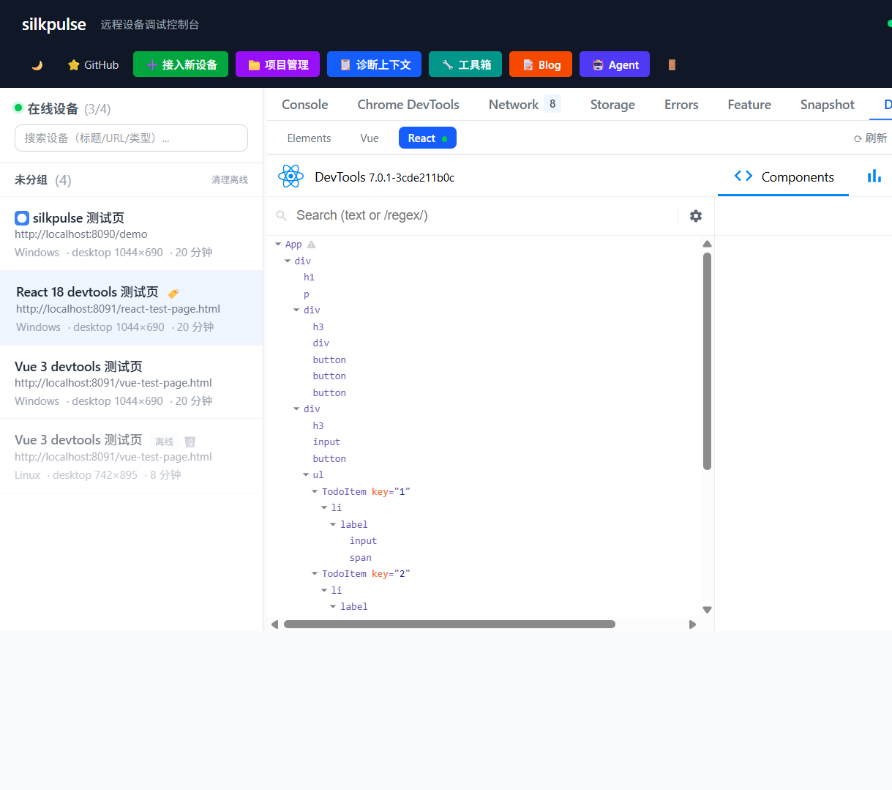

<div align="center">

# 🩺 silkpulse

### 让 AI 接管前端线上排障

console · 网络 · 报错实时上报，把千里之外的 debug 现场搬进你的浏览器

[](https://github.com/2234839/silkpulse/actions/workflows/ci.yml)
[](LICENSE)
[](https://silkpulse.heartstack.space)
[](https://mp.weixin.qq.com/s/ipLbaflx6i92cgUURgkkLQ)

</div>

---

> 用户端调试——尤其是手机上的内嵌 WebView——是排障的老大难：让用户开 vConsole、截图、复制日志，来回折腾半天；AI 更难介入。
>
> silkpulse 的做法：**页面里插一个 script 标签**，console、网络、报错实时上报到网页控制台——你人工看，或**直接让 AI 排查**。

<p align="center">
  
  
  
</p>

## 和同类工具比

对比对象：vConsole · PageSpy · chii

- **嵌的是官方 DevTools** —— 同类只能看 DOM 树，silkpulse 直接嵌官方 vue/react-devtools 面板，生产构建照样看组件树 / state / hooks
- **给 AI 留了 HTTP 接口** —— 自带 skill：读快照、日志、网络（含响应体），还能在远程页面执行 JS 做验证，定位→验证一次会话走完
- **流式响应逐事件可看** —— AI 时代满屏 SSE：网络面板内置事件流查看器，逐条 token 实时追加，还能用 JS Parser 抽字段、把跨 chunk 的连续 JSON 智能重组——LLM 接口吐了什么、流在哪断的，一目了然

## 它能做什么

- **看** —— 页面快照、console、网络请求、报错堆栈（自动 sourcemap 还原真实位置）
- **动** —— 远程执行 JS、点击、填表单、滚动、模拟按键
- **多设备** —— 多设备同时接入，标签区分、错误高亮、断线重连历史不丢

### 流式响应：AI 时代的网络面板

接 AI 服务的页面离不开 SSE / WebSocket 流式接口。silkpulse 不只是把流录下来，网络面板里有专门的事件流查看器（对齐 DevTools 的 EventStream 面板），且面向 LLM 场景做了增强：

- **实时事件时间线** —— 逐条 `data:` 事件实时追加；连接中 / 已关闭状态、持续耗时与累积大小随流增长，流在哪断的最后一个 token 一目了然
- **Parser 变换** —— 写一行 JS（如 `return JSON.parse(data).msg`）把每条事件变换后再展示，从满是噪声的流里直接抽出业务字段；按域名自动记忆历史
- **JSON 模式** —— Agent 常见的连续 JSON 流（`{..}{..}{..}` 一个 JSON 被拆到多个 chunk）按值边界智能切分重组，不再被半截 JSON 糊脸
- **关键词 Filter** —— 事件 / WS 帧按关键词过滤，与 Parser 可叠加

采集侧三路全覆盖：`fetch` 的 `text/event-stream` 用 `tee()` 拆流旁路采集（业务流零影响）、`EventSource` 原生劫持（含自定义 `event:` 类型）、WebSocket 双向逐帧。

典型场景：页面接了 LLM 的流式接口，用户说「AI 回答没出来」——打开网络面板直接看这条 SSE 连接：是 401 被拒、流中途断掉、还是 `data:` 里只有错误信息，不用再猜。

## 在线体验（60 秒上手）

1. 打开[控制台](https://silkpulse.heartstack.space)，登录页点「**游客进阶 → 创建我的项目 Key**」——免费免注册，生成一个只属于你的临时项目（5 天有效，Key 只展示一次，立即保存）
2. 用 Key 登录 → 点「**➕ 接入新设备**」，选一种接入代码贴到你的页面上（script 标签 / bookmarklet / 油猴脚本，都不用改源码）
3. 回到控制台，设备、console、网络请求、组件树都出现了

> 🔒 上报的是页面完整现场（console / 网络请求含响应体 / DOM / 组件 state）。想随便看看可用「游客访问 Playground」公共项目——但公共数据全员可见，**别拿有登录态或敏感信息的页面去接**。长期使用建议[自己部署](#快速开始)。

## 快速开始

要求：Node ≥ 22、pnpm ≥ 11

```bash
pnpm install
pnpm build    # 构建全部包
pnpm start    # 启动，默认端口 8080
```

浏览器打开 `http://localhost:8080` 即是控制台，`http://localhost:8080/demo` 是已接入 SDK 的测试页。

### Docker 部署

官方镜像 [llej0/silkpulse](https://hub.docker.com/r/llej0/silkpulse)（amd64）：

```bash
docker run -d --name silkpulse -p 8080:8080 \
  -v ./data:/app/data \
  -e SILKPULSE_ADMIN_KEY=<你的密钥> \
  llej0/silkpulse:latest
```

或用仓库根的 `docker-compose.yml`：`SILKPULSE_ADMIN_KEY=<你的密钥> docker compose up -d`。

自行构建：`bash scripts/docker-build.sh [版本号]`（会先 pnpm build，native 文件与构建机架构/Node ABI 需一致，镜像基底为 node:24-slim）。

### 源码部署

构建产物自包含，无需 node_modules（`dist/` 里含平台相关的 native 文件，目标机架构需与构建机一致）：

```bash
rsync -avz --delete packages/server/dist/   root@<server>:/app/silkpulse/dist/
rsync -avz --delete packages/server/public/ root@<server>:/app/silkpulse/public/
SILKPULSE_ADMIN_KEY=<你的密钥> node /app/silkpulse/dist/bin/silkpulse.mjs --port 8080
```

不设置 `SILKPULSE_ADMIN_KEY` 则鉴权关闭（启动日志会警告），生产环境务必设置。

Nginx 反代时记得放行 WebSocket 升级（`Upgrade` / `Connection` 头）。

## 让 AI 用起来

AI agent 通过 silkpulse skill 一句话排查问题：

```bash
node tools/skill/scripts/silkpulse.mjs devices      # 在线设备
node tools/skill/scripts/silkpulse.mjs inspect <id> # 一键诊断聚合（AI 最高效入口）
node tools/skill/scripts/silkpulse.mjs exec <id> "return location.href"  # 在远程页面执行 JS
```

完整用法见 [tools/skill/SKILL.md](tools/skill/SKILL.md)。

## 想深入了解

- **架构与实现细节**：[SILKPULSE_KNOWLEDGE.md](SILKPULSE_KNOWLEDGE.md)
- **项目结构**：`packages/`（server、sdk、renderer、feature-detect、shared）+ `apps/console`（控制台 UI）+ `tools/skill`（AI skill）

## 社区

和开发者一起交流项目使用经验、讨论问题、分享想法：

[](https://tsfullstack.heartstack.space/group/gs?from=silkpulse)

感谢 [阮一峰的科技爱好者周刊（第 416 期）](https://www.ruanyifeng.com/blog/2026/10/weekly-issue-416.html#:~:text=6%E3%80%81silkpulse) 收录本项目 🎉

感谢 [LINUX DO](https://linux.do/t/topic/2765326) 社区佬友们的支持与反馈 🙏

[](https://linux.do/t/topic/2765326)

## License

MIT
